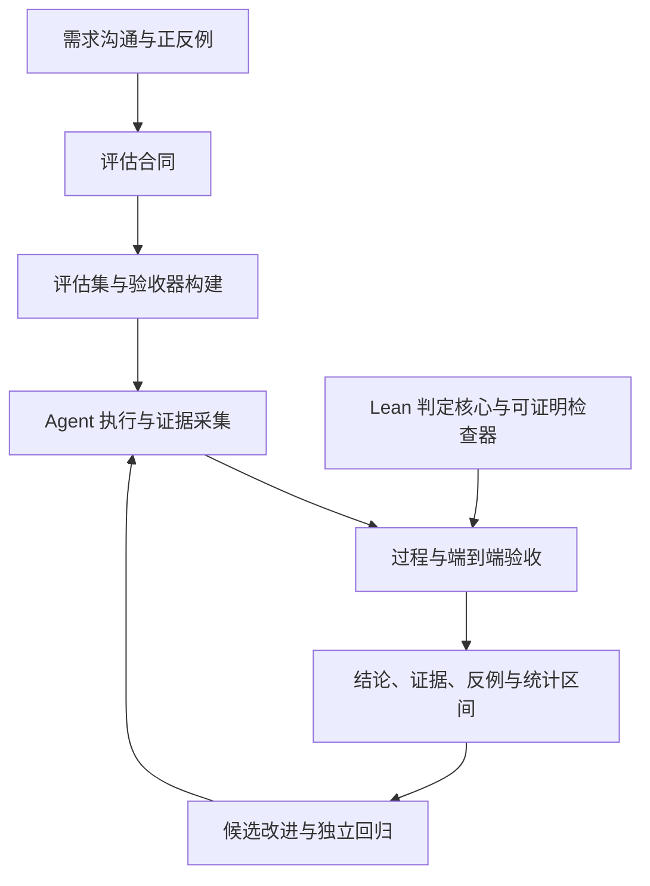

# Lean 4 Agent Eval

将用户的 Agent 需求转化为可执行评估合同，自动构建评估集与验收器，联合检查执行轨迹和最终产物，并通过形式化验证、实验统计与人工校准，为每个评估结论提供依据与适用边界。

面向编程、数据分析、PPT 与文案等办公 Agent。第一条业务链路是 **销售数据分析 → 分析结论 → 五页 PPT 交付**。

## 产品工作流

1. **拆解需求**：用少量沟通和正反例明确目标、输入、交付物、约束、风险及待澄清问题。
2. **编译评估合同**：为每条要求建立验收条件、证据要求、检查器及需求来源；关键歧义阻止合同冻结。
3. **构建评估集**：生成正常、边界、异常和对抗场景，为每例建立可信的参考结果或性质检查；开发集与保留验收集隔离。
4. **执行并取证**：在受控环境运行被评估 Agent，独立采集工具事件、状态变化和实际产物。
5. **分层验收**：分别检查过程约束、最终结果和开放式质量；缺证据时保留未知，评估器故障时保留错误。
6. **迭代与回归**：依据失败案例提出改进，在固定合同和独立验收集上复测；修改标准必须形成新版本。



## 当前状态

当前版本是 **产品架构与合同骨架**。结构检查通过不代表 Agent 业务通过。

| 能力 | 当前交付 |
|---|---|
| 产品定位、模块边界、数据流、实施里程碑 | 已定义 |
| 评估合同、检查回执的数据结构 | JSON Schema 与离线合同校验器 |
| 销售分析到 PPT 样例 | 人工编写的需求、合同、合成 CSV、参考结果、场景与评分器反例计划 |
| 类 Lean 判定核心 | 11 个 Lean 命名定理，覆盖非空必检集、失败优先、遗漏必检项阻止通过等性质 |
| 自然语言需求拆解、合同自动生成 | 接口已定义，待实现与用户校准 |
| 自动生成场景、真实 Agent 执行、证据采集 | 接口与要求已定义，待实现 |
| PPT 解析与渲染验收、模型裁判 | 待实现；样例不包含伪造的 Agent 运行结果 |
| 自动改进与保留集回归 | 实验策略已定义，待实现 |

## 第一版样例

输入为一份合成销售明细。任务要求按明确口径比较 2026 年 9 月和 10 月净销售额，解释可由数据支持的变化贡献，并交付 `analysis.json` 与五页中文 `report.pptx`。

评估检查统计口径与数值、分组加总、结论依据、PPT 内容与实际渲染、跨产物数字一致性，以及输入来源和操作权限。分组贡献不能直接解释为已经证实的业务因果关系。

从 [样例说明](examples/sales-to-ppt/README.md)、[需求](examples/sales-to-ppt/request.md)和[合同](examples/sales-to-ppt/contract.json)进入。

## 本地检查

Python 3.11+。以下命令校验仓库资产，不调用模型或外部业务系统，也不会生成 PPT。

```sh
python3 -m venv .venv
.venv/bin/python -m pip install -r requirements-dev.txt
.venv/bin/python scripts/check_project.py
.venv/bin/python -m unittest discover -s tests -v
```

形式模型检查要求 `lake` 已在 PATH，工具链固定于 [formal/lean-toolchain](formal/lean-toolchain)。

```sh
python3 scripts/check_formal.py
```

该脚本构建形式模型、审计命名定理的公理依赖，并运行四个负向控制。检查回执写入忽略提交的 `.artifacts/formal-verification.json`。这些检查不证明 Python 校验器、数据真实性、trace 完整性或 PPT 质量。

## 项目布局

```text
docs/                         产品架构、合同语义、验证边界、实施路线
schemas/                      评估合同和检查回执 JSON Schema
src/lean4_agent_eval/          合同校验器及未来模块接口
formal/                       Lean 判定核心与公理审计
examples/sales-to-ppt/         首条业务链路的产品验收样例
scripts/                      仓库资产与形式模型检查
tests/                        合同校验器的失效边界回归
```

详细设计：[系统架构](docs/architecture.md) · [合同与结论语义](docs/evaluation-contract.md) · [验证边界](docs/verification-boundary.md) · [实施路线](docs/roadmap.md)。

## 结论应当如何解释

- **形式证明**说明某条精确定义的性质，在声明的模型与前提下成立。
- **确定性检查**说明指定输入与产物通过了指定检查器。
- **实验统计**说明固定版本在被抽样的任务和运行条件下表现如何。
- **质量评分**需要说明量表、校准数据和人工复核范围。

每次验收保留 `PASS / FAIL / UNKNOWN / ERROR` 及逐项证据。硬性违规不能被平均分抵消，未知与故障不能算作通过。项目只维护产品设计、实现和验收资产。
