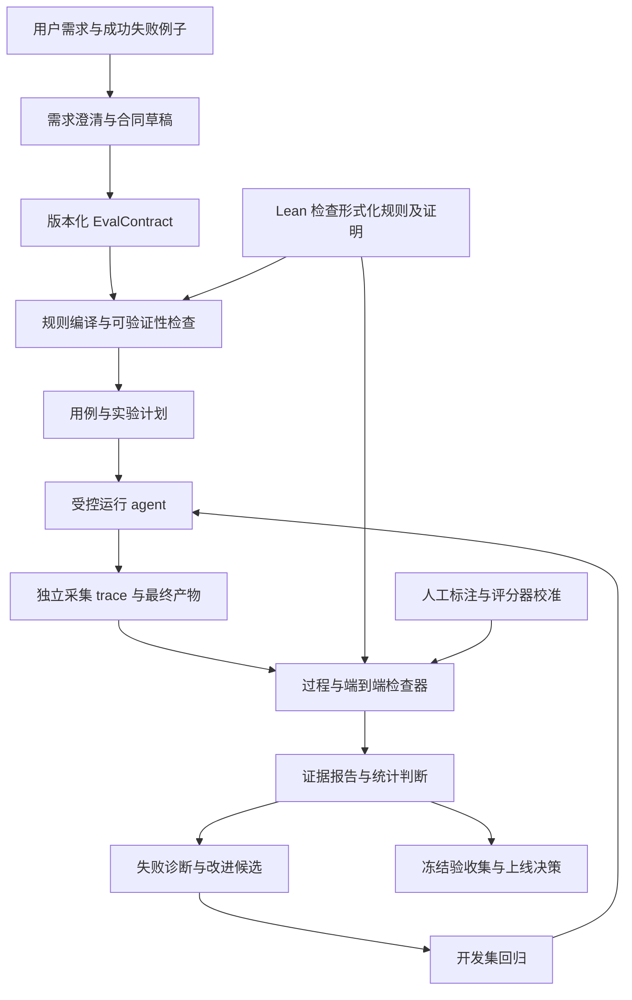

# 从简单沟通到自动化评估：架构 v0.1

本文是本项目的设计提案，不是已实现系统或经验证的通用方法。

研究基础可分别参考 [EvalGen](https://arxiv.org/abs/2404.12272) 的评估标准生成与人类校准、[Agent-as-a-Judge](https://arxiv.org/abs/2410.10934) 的过程中间反馈、[AgentSpec](https://arxiv.org/abs/2503.18666) 的运行时规则，以及作者公开的 [AgentSpec 与 Lean 形式化研究稿](https://jfulfo.github.io/files/agentspec-formal.pdf)。本项目尚未复现这些实现；下述架构是对办公评估的设计组合，不主张这些基础思想首次提出。

## 产品承诺

用户描述任务并回答少量关键问题后，系统产出一个可审查的评估包：成功标准、必检环节、所需证据、评分规则、测试集草案、实验预算和迭代策略。不能自动核验的要求会明确标注，并进入人工校准或补充证据流程。

“简单沟通”的实现依赖可复用的办公任务模板、已有数据和合理默认值。沟通可以简短，但系统内部必须保留假设、歧义与规则来源。

## 总体结构



这里的“合同”指精确、版本化的验收约定，不是法律文件。

## 1. 需求澄清：问有决策价值的问题

最少需要覆盖六类信息，但不要求逐项问六个问题；可从文件和上下文提取，向用户展示理解结果并只补关键缺口。

| 信息 | 示例 |
|---|---|
| 成果与受众 | 给部门负责人准备季度经营分析 PPT |
| 输入与权威来源 | 哪个表、哪个版本、字段如何解释 |
| 成功标准 | 数字准确、解释有据、可打开、可用于汇报 |
| 必须遵守的约束 | 不改原始数据、只使用约定范围数据 |
| 取舍 | 时效、质量、成本、人工介入的关系 |
| 正反例 | 一份满意的结果、一种不可接受的失败 |

系统将规则分别标记为 `user_explicit`、`source_derived`、`proposed_default`、`unresolved`。推断出的阈值不伪装成用户要求。关键口径没有明确时可以先运行探索，但不能生成正式验收结论。

## 2. EvalContract：一个需求对应一组检查义务

建议的中间表示包含：

```yaml
contract_id: office-report-demo
version: draft-0.1
status: draft
goal: 使用指定数据完成统计与汇报
scope: [trace, end_to_end]
input_contract: {snapshot: required, units: required, population: required}
assumptions: []
unresolved_questions: []
requirements:
  - id: total_consistency
    origin: user_explicit
    claim: 最终材料的净额与约定口径独立计算的净额一致
    scope: end_to_end
    severity: hard
    evidence: [source_snapshot, calculation_spec, final_artifact]
    verifier: independent_recompute
    formal_status: not_proven
    missing_evidence: UNKNOWN
experiment:
  target_population: unresolved
  split_policy: task_family_and_source_group
  primary_metric: end_to_end_success
  sample_size: unresolved
  budget: unresolved
```

这是字段草案，尚无执行这个 YAML 的编译器。每条规则必须能追溯到用户要求或明确的提议，并列出证据、判断方法、适用边界和失败处理。

编译阶段检查：类型和字段、单位与范围、规则冲突、所需证据能否采集、评分器是否存在、该规则属于可判定的形式化子集还是经验判断。有限模板可做矛盾检测或构造满足实例；任意自然语言规则不承诺自动判断一致性。不能支持的规则保留为未解决项。

## 3. 验证器分工

| 验证方式 | 适合检查 | 不足 |
|---|---|---|
| 确定性程序 | schema、精确重算、测试结果、文件结构、已定义状态变化 | 程序和规范可能都写错 |
| 形式化验证 | 狭窄检查器的可靠性、状态转移不变量、验收聚合逻辑 | 只涵盖被建模的对象和前提 |
| 统计实验 | 任务成功率、重复稳定性、改进幅度和不确定性 | 受样本代表性和实验设计限制 |
| 经校准的模型评分 | 论据支持度、内容完整性、表达与受众适配 | 可错判，必须保留证据和抽审 |
| 人工判断 | 业务意义、审美偏好、歧义裁决、校准样本 | 成本高、也可能不一致 |

程序、模型和人工评分组合是已有 agent 评估实践；这里加入受限的形式化规则层是本项目的设计选择。[Anthropic 工程说明](https://www.anthropic.com/research/demystifying-evals-for-ai-agents)

## 4. Trace 全链路评估

全链路指**实际可观测的行为和产物链路**，不承诺看到模型内部全部推理。模型自述“我已核验”只是自述，不能替代工具返回值和环境状态。

建议采集：run/task/attempt ID、agent 和配置版本、父子 span／因果连接、工具调用 ID、输入输出产物引用、数据与环境快照、动作参数、授权依据、错误／重试、耗时和成本。对敏感值保存受控引用和必要的脱敏内容；内容哈希用于一致性，不能证明上游事实真实。

关键检查范围：

| 环节 | 问题 | 可用证据 |
|---|---|---|
| 需求与输入 | 使用了哪一版口径与文件？ | 合同、数据快照、实际读取记录 |
| 检索／读取 | 关键来源是否确实取得？ | 工具返回、文档位置、访问错误 |
| 计算／代码 | 计算口径、单位和执行是否对应？ | 脚本、命令、结果、独立重算 |
| 分析 | 结论由哪些数据支持？ | claim 到表／图／文段的映射 |
| 产物 | 数据如何进入最终文件？ | 产物版本、提取值、渲染截图 |
| 恢复与边界 | 失败后是否重复副作用、超限或遗漏？ | 事件状态、幂等标识、外部状态 |

采集器放在运行器／工具网关一侧，不能只接受待评估 agent 自己编写的日志。已知断档返回 `UNKNOWN`；采集器记录损坏或检查器崩溃返回 `ERROR`。若已知 agent 交付的产物违反合同约定的格式，则是 `FAIL`，不能用评估故障掩盖业务失败。仅凭“日志没有违规”不能证明没有未观测动作。

不要把一条参考轨迹当作唯一正确路径。评价必要约束、里程碑、数据依赖和禁止动作，允许换工具、并行和合理重试。并发时使用因果先后关系，不能仅靠墙上时钟给事件排序。OpenTelemetry 可作为字段互操作参考；证据闭合和业务验收还需另外实现。[官方 GenAI 仓库](https://github.com/open-telemetry/semantic-conventions-genai)

## 5. 端到端评估

端到端以最初输入和用户实际收到的结果／环境状态为对象。过程评分高，不能弥补最终文件打不开或核心结论错误。

| 任务 | 结果验收 | 典型过程检查 | 需要经验／人工判断的部分 |
|---|---|---|---|
| 编程 | 干净环境中功能、回归、可执行交付 | 修改范围、真实测试日志、依赖版本 | 需求匹配、可维护性、交互体验 |
| 统计 | 与独立口径计算一致；舍入与单位正确 | 数据版本、去重、缺失值和过滤过程 | 口径是否适合业务问题 |
| 挖掘分析 | 可复算、留出数据表现、结论与证据相符 | 数据泄漏、假设、模型选择、实验划分 | 因果解释、代表性和行动价值 |
| PPT | 文件打开、渲染、数字／图表／来源一致 | 数据到图表到页面的映射 | 布局、叙事、读者理解和说服力 |
| 文案／报告 | 覆盖需求、事实有据、引用准确 | 来源取得、版本和改写依据 | 风格、论证质量、受众适配 |

“事实有据”还应拆成来源存在、引文匹配、来源是否支持断言、来源本身是否可靠。URL 存在只能检查第一项。

## 6. 哪些东西先用 Lean

第一优先级是**小型、稳定、可复用的检查器**，不试图一次证明整个开放世界 agent。

目标形状例如：

`∀ x, checker(x) = PASS → Spec(x)`

这称为检查器相对规范的可靠性：不会对违反该规范的输入误放行。还可以研究 `Spec(x) → checker(x) = PASS`，即不会误拒绝。但语义模糊或信息不足的任务通常不能同时实现全自动、总能判定、完全可靠与完全完备。

更贴近现实的版本包含输入有效性和完整性前提。必须另行核验这些前提；不能写成“假设 trace 真实完整”后就声称真实执行已被证明。

有三条实施路线，依阶段选择：

1. Lean 实现狭窄纯函数检查器并证明其性质；运行部署仍有解析器、编译器和环境信任边界。
2. 复杂程序生成证据，较小的核验器检查证据；只有真正形式化并核验的部分才称为证明。
3. Python 检查器与 Lean 模型分别实现，做差分测试。这是工程证据，**没有建立实现等价证明前，不能称 Python 已形式化验证**。

后续应锁定规则定义、公理允许列表、工具链与依赖，并让最终证明在独立干净进程中复查。形式化合同编译器本身若未经证明或验证，也属于信任边界。[Lean 证明验证指南](https://lean-lang.org/doc/reference/latest/ValidatingProofs/)

## 7. 判决与证据报告

单条规则返回 `PASS / FAIL / UNKNOWN / ERROR`，并带 rule_id、证据引用、检查器版本和解释。`UNKNOWN` 是缺证据或无法确定，`ERROR` 是评估执行故障；二者不伪装成 agent 业务失败。

汇总报告保留所有规则结果：任何确认的硬性违规都足以阻止验收；即使同时有评估错误，也保留已知违规。没有违规但存在必检 `UNKNOWN/ERROR` 时也不能签发通过。空规则集不是成功任务。软评分单独报告，不能平均抵消硬性违规。

报告分别写明：本次观测、推测的失败原因、改进建议和验收决策。故障归因如果未通过对照／复现实验，仅标为假设。

## 8. 自动迭代边界

循环：失败证据 → 故障分类 → 改进假设 → 修改候选 → 开发集实验 → 回归 → 冻结验收 → 结果记录。

优化器能修改什么、最多运行多少次、预算和停止条件写入实验计划。正式评估的规则、标注和验收集不能由优化器为了提高分数自行更改。真实需求变更时另建合同版本，保留旧版本结果，不能直接拼接成同一条提升曲线。

执行器可复用 Inspect 等框架；自建的重点是合同、证据、办公适配器和可信判断。这只是候选方向，需在真实试点比较接入成本与能力后决定。[Inspect 文档](https://inspect.aisi.org.uk/)
