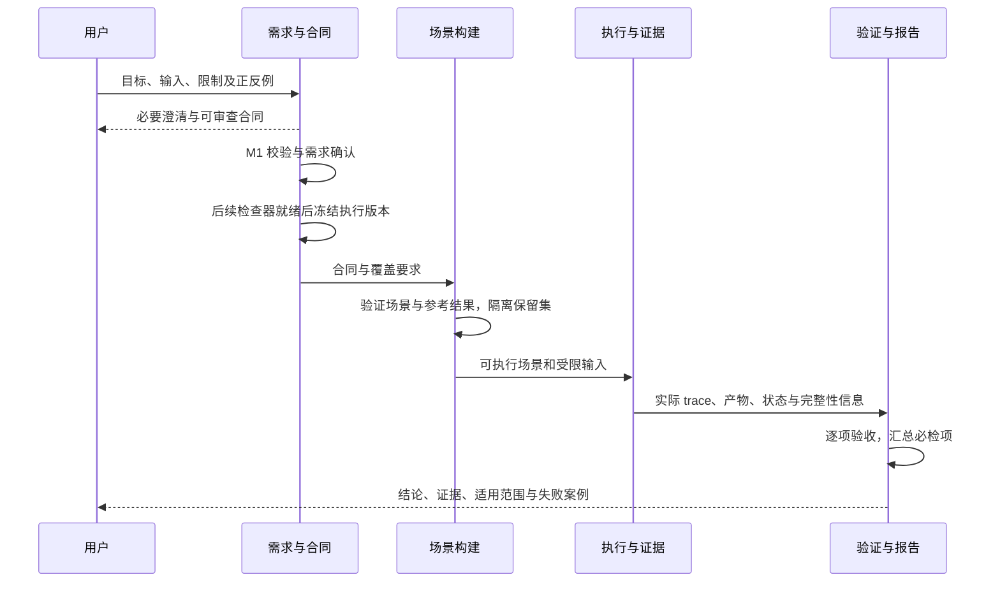

# 系统架构

状态：M1。已有销售到 PPT 的规则式沟通、澄清、标准生成与确认流程，以及合同静态校验和 Lean 判定模型；真实业务执行链路尚未接通。

## 系统责任

输入是用户需求、可用输入与 Agent 接入方式。输出是可追溯的评估合同、版本化评估集、可复核的检查回执和实验报告。被评估 Agent 可以来自任意框架；本系统负责评估，不默认负责创建业务 Agent。

## 模块与接口

| 模块 | 输入 → 输出 | 核心责任 | v0.1 |
|---|---|---|---|
| Intake / Spec Compiler | 需求与沟通记录 → 合同草案或澄清项 | 拆解目标、约束、例外；保留需求来源；建立标准 | SalesSpecCompiler + 本地 CLI |
| Contract Validator | 合同 → 静态问题清单 | Schema、引用、必检覆盖、确认哈希、冻结条件 | 有限静态校验 |
| Case Builder | 冻结合同与覆盖计划 → 场景集 | 输入变体、参考结果、反例和集合划分 | Protocol；人工样例 |
| Agent Adapter / Runner | 场景与执行配置 → 运行记录 | 环境隔离、实际调用、预算、工具拦截、产物收集 | Protocol |
| Evidence Store | 运行记录 → 证据清单 | 内容哈希、来源、完整性、原始事件和访问控制 | 边界已定义 |
| Verifier | 检查项与证据 → CheckReceipt | 确定性、过程策略、质量量表、人工复核 | Protocol 与 Schema |
| Verdict Core | 必检 ID 与检查回执 → 总结论 | 缺项不通过、失败优先、保留全部诊断 | Lean 模型；运行时绑定待实现 |
| Campaign / Reporter | 固定版本与重复实验 → 报告 | 分层结果、置信区间、错误率、版本对比 | Protocol |

接口入口：[ports.py](../src/lean4_agent_eval/ports.py)，M1 使用说明见 [intake.md](intake.md)。当前编译器采用确定性领域规则；未来模型生成的合同、用例、检查器同样是候选内容，必须经独立校验。

## 数据生命周期

草案可以包含规划中的检查器；冻结前要求关键问题已解决、必检项有可用实现与校准依据。当前静态校验不验证确认人真实性或实现注册表，生产冻结门禁必须补齐这两项。

M1 的 `needs_clarification → ready_for_review → requirements_confirmed` 只管理需求审查。关键字段缺失/冲突时不输出完整合同；确认绑定完整提议内容的哈希，更正使确认失效。所有生成合同仍为 draft，不越过后续执行门禁。

## 核心对象

- `EvaluationContract`：目标、原始需求、假设、输入/交付物、要求 ID、检查项、证据要求、判定和实验策略。
- `CaseBundle`：合同版本及哈希、场景 ID、输入与初始状态、参考结果或性质、权限、集合划分、种子。
- `RunBundle`：场景及合同标识、Agent/模型/提示/工具/环境版本、预算、原始事件、产物和采集状态。
- `EvidenceManifest`：执行边界生成的证据 ID、生产者、位置、内容哈希、时间与覆盖范围。Agent 自述只属于待评内容。
- `CheckReceipt`：运行与合同绑定、检查器版本、消费的证据、判定、理由、验证层级。
- `CampaignReport`：逐项回执、任务分层、失败/未知/故障计数、样本数与区间、复现配置及未覆盖项。

内容绑定使用规范化 JSON 的 SHA-256：UTF-8、键排序、无额外空格且禁止 NaN。M1 审查哈希仅排除确认记录自身；未来执行回执须绑定最终冻结合同的完整哈希，二者不可混用。数据、Agent、检查器或量表变化后，旧回执不能复用为新版本证据。

## 自动构建评估集与验收标准

1. 建立需求覆盖矩阵，区分可计算结果、必要过程约束与开放质量要求。
2. 提出检查器及证据，用正例、反例校准标准。
3. 构造正常、边界、异常、工具故障和攻击输入；每个变体关联要求 ID。
4. 验证输入可执行、目标可达、参考结果可信。无法独立确认答案时，使用可验证性质或人工标注。
5. 用错误金额、错误单位、无依据结论、缺失证据、关键词堆砌等产物攻击评分器。
6. 按业务模板/数据来源等分组划分开发、校准和保留验收集，防止近重复泄漏。

参考答案与隐藏检查不得进入 Agent 上下文。生成的可执行检查代码须在限制文件、网络、资源和副作用的独立环境内运行。

## trace 与端到端验收

端到端检查实际产物和最终环境状态。trace 检查数据来源、权限、依赖顺序、外部动作、成本及可恢复性。两者分别报告，再按合同汇总。

只约束必要行为，允许多种合理解法。trace 是可观察交互与动作，不依赖模型私有思维链。事件由 Runner/工具边界采集，包含参数、返回值引用、父事件、状态变更和错误；仅出现工具名不能证明正确使用了工具。

明确违规判 `FAIL`；证据不足判 `UNKNOWN`；采集器或评估器故障判 `ERROR`。在采集完整且任务已结束时缺少必交文件，判 `FAIL`。全部诊断保留，失败优先汇总不丢弃并存错误。

## 验证核心边界

Lean 模型仅处理必检 ID 到判定的映射。输入边界须校验 ID 唯一、合同/运行/版本匹配，拒绝冲突回执，核对证据与完整性，再映射为模型输入。缺少回执映射为 `UNKNOWN`。

Python 与 Lean 的等价性、序列化器、证据真实性及业务检查器目前不在证明范围。未来可直接调用验证核心或使用可复核证明凭据；仅引用定理不足以宣称运行时受形式保证。

## 自动迭代与部署

冻结合同、检查器和验收集后建立基线。失败定位先形成可检验假设，再变更 Agent、提示或工具；开发集调优后做预算预设的配对回归。保留集不反馈给优化器；反复使用后应轮换或修正实验设计。

不能为提高通过率自动放宽标准。修正标准要形成新版本并重建基线。报告成本、延迟、覆盖、任务成功率、未知率、评估故障率，分别解释 `pass@k` 和重复可靠性。

MVP 优先 Python 命令行与文件产物，Lean 为独立核心；模型、Agent 框架、对象存储和 PPT 渲染器通过适配器接入。跑通单条业务闭环后，再按并发需求引入队列、数据库和 Web 界面。
