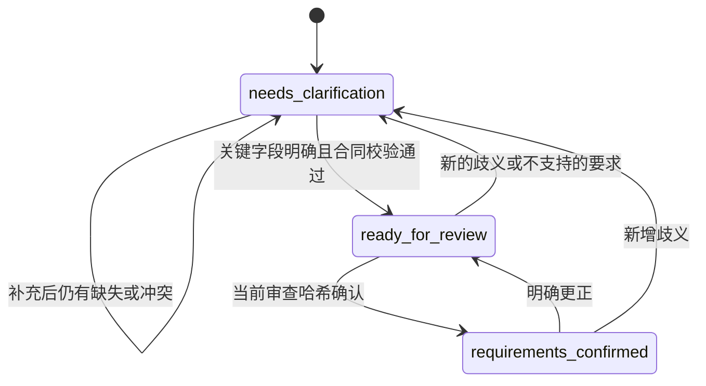

# M1：沟通到评估合同

本版实现 `SalesSpecCompiler`，使用确定性领域规则解析简短中文和部分英文术语。不调用 LLM，不声称理解任意办公需求。自由文本无法可靠识别时可通过问题 ID 单独回答；新增领域或口径需要扩展规则和测试。

## 明确支持的范围

| 问题 ID | 需要明确的内容 | 支持的例子 |
|---|---|---|
| `input_path` | 单份 CSV 路径 | `input/sales.csv`；含空格/中文路径可单独按字段回答 |
| `periods` | 两个完整绝对月份 | `基期2026-09，对比期2026-10` |
| `data_model` | 数据粒度 | `一行一订单` / `订单快照` |
| `time_basis` | 归月日期 | `订单业务日期` / `business_date` |
| `metric` | 指标定义 | `净销售额` / `毛销售额` |
| `status_policy` | 纳入的状态 | `仅paid订单`；单字段可回答 `paid` |
| `currency_unit` | 原始金额币种和单位 | `CNY 分` / `人民币元` / `USD cents` |
| `refund_policy` | 退款归属；毛额不需要此项 | `退款扣回原订单月份` |
| `group_by` | 贡献拆分维度 | `region` / `channel` / `product`，可组合 |
| `analysis_scope` | 分析结论范围 | `变化贡献` / `贡献分析` |
| `slide_count` | PPT 页数 | `五页` / `15页`；单字段可回答 `5`；限 3–20 页 |
| `language` | 单一交付语言 | `中文` / `英文` |
| `audience` | 读者 | `给经营负责人`；单字段可提供其他读者描述 |
| `external_policy` | 外发约束 | `仅本地交付不外发` / `审批后外发` |

相对日期不依赖机器时钟推断；按日区间不自动扩成整月。多币种、退款流水、支付日期归月、预测、同比/季度、利润等需要新的定义和检查器。识别到否定、备选、不确定或冲突时保留问题。

规则解析不能保证捕获所有混合语句中的额外需求，审查稿必须与原始需求对照。超出表中范围时应扩展模板，而不是把未识别内容当作已经覆盖。M1 也不读取 CSV 内容来猜业务语义，输入检查在后续执行阶段完成。

## 状态与确认



- `needs_clarification`：`contract: null`，无法导出完整合同。
- `ready_for_review`：自动生成合同、逐项来源和验收标准，返回 `review_sha256`。
- `requirements_confirmed`：确认人元数据与精确审查内容绑定。后续补充或更正使确认失效。

三个状态均不意味着真实 Agent 已通过。生成合同为 `draft`，`execution_ready: false`，必检验收器仍标为 `planned`。

哈希针对 UTF-8、键排序、无额外空格、禁止 NaN 的完整合同 JSON，仅排除 `intake.requirements_confirmation` 自身。它检测内容变化，不认证确认人身份，也不能抵抗有人同时改写内容和重算哈希的攻击。接入服务后仍需认证与受保护的审计日志。

## 命令行

以下命令在仓库根目录执行，安装方式见 README。

```bash
# 开始；不会覆盖已有会话
.venv/bin/python scripts/intake.py intake \
  --request '帮我分析销售数据，五页中文PPT给经营负责人，说明变化贡献。' \
  --session .artifacts/session.json

# 一次补充多个字段
.venv/bin/python scripts/intake.py reply \
  --session .artifacts/session.json \
  --message '使用 input/sales.csv；基期2026-09，对比期2026-10。'

.venv/bin/python scripts/intake.py reply \
  --session .artifacts/session.json \
  --message '输入是订单快照，按订单业务日期归月；按净销售额，仅paid订单；原始金额CNY分；退款扣回原订单月份。按region拆分；仅本地交付不外发。'

# 单字段更正
.venv/bin/python scripts/intake.py reply \
  --session .artifacts/session.json --field slide_count --message '更正为六页'

# 阅读完整验收标准、编译器提议及审查哈希
.venv/bin/python scripts/intake.py show --session .artifacts/session.json

# 使用 show 对应的真实哈希；不要把这里的占位文本直接作为批准
.venv/bin/python scripts/intake.py confirm \
  --session .artifacts/session.json --review-sha256 '<当前审查哈希>' --by '<确认人>'

.venv/bin/python scripts/intake.py export \
  --session .artifacts/session.json --out .artifacts/my-contract
```

`export` 也允许导出尚待用户确认的完整草案，但保留状态。导出是某一版本的快照，不会因为后续更正而改写旧文件；消费者必须核对当前会话、确认状态和哈希，不能仅因文件存在就执行。

导出包含 `contract.json`、`review.md`、`session.json` 和 `result.json`。`intake/reply/show/confirm/export` 均不调用模型或业务工具。无效会话、错误字段、旧哈希或不完整导出返回非零退出码。

交互模式 `chat` 支持一次补充多项、审查后输入“确认”，以及输入“退出”保存。未识别的独立补充会阻止审查；若确实不再需要，可明确输入“撤回上一条未识别补充”。

## Python API

从源码导入时将 `src` 加入 Python 模块路径，例如 `PYTHONPATH=src .venv/bin/python`。

```python
from lean4_agent_eval.intake import new_session, reply, compile_session, confirm

session = new_session("帮我分析销售数据，五页中文PPT给经营负责人，说明变化贡献。")
result = compile_session(session)
assert result["state"] == "needs_clarification"
assert result["contract"] is None

session = reply(session, "使用 input/sales.csv；基期2026-09，对比期2026-10。")
# 继续补齐 result['questions'] 所需字段后，再生成、审查并确认。
```

`SalesSpecCompiler().compile(request, answers)` 接受以问题 ID 为键、文本回答为值的映射，返回相同的澄清/审查 envelope，满足 `SpecCompiler` 接口。它不会自动确认。

## 验收标准如何生成

`contract_builder.py` 从已明确字段构建六组要求：输入/口径、数值与分组、结论依据、文件交付、跨产物质量、权限。检查项中的日期、公式、币种、单位换算、维度、页数、语言、读者和权限随字段变化，不拷贝基准参考答案。

每个已明确字段关联 `T001` 等来源轮次；要求关联字段及来源，检查项关联要求与证据。通用的数据质量规则、analysis.json 伴随交付、量表和阈值属于编译器提议，必须随合同一起审查。

M1 自动生成验收标准及检查器配置。M2 已基于确认合同实现评估集、双实现参考计算及局部数值/合成 PPT 字段评分器，见 [评估集与参考核验](evaluation-dataset.md)。完整业务检查器注册、实际文件和 trace 验收仍待 M3；M1 合同不会因为 M2 的局部检查器可用而自动冻结。
